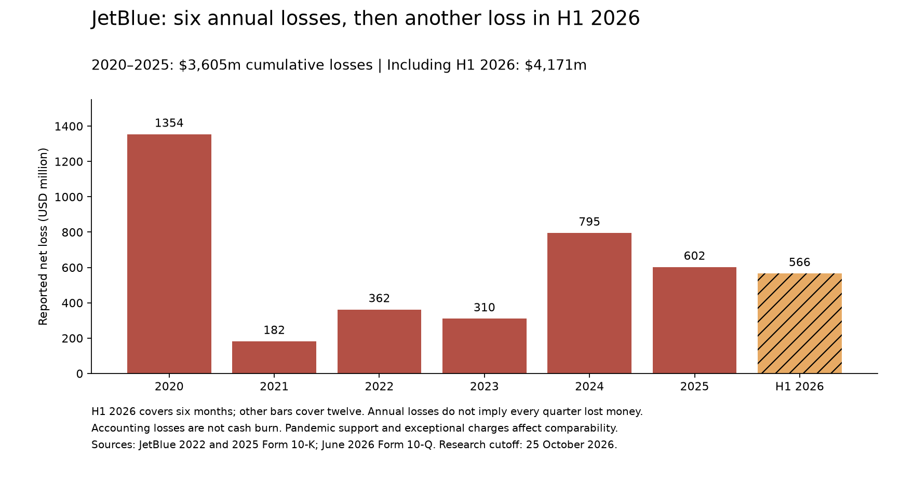
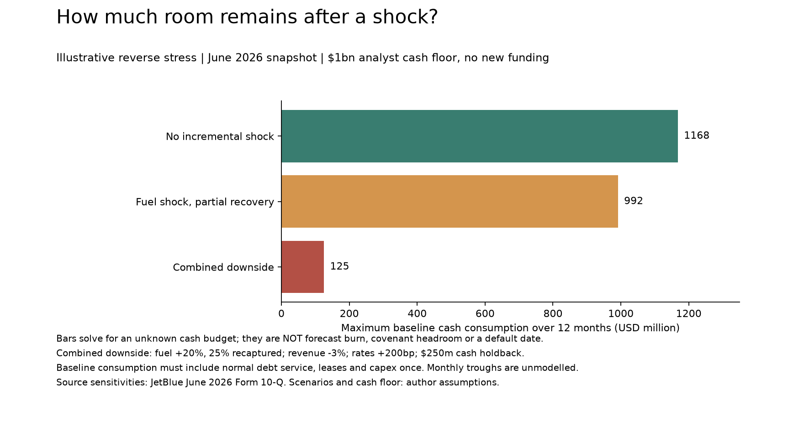

# Airline credit: who can fund the next difficult year?

Research cutoff: **25 October 2026**. This edition adds a loss history, contractual warning signs and a reproducible reverse stress test. It does not provide a verified sector ranking or predict a default date.

[Open the Python workbook](../notebooks/credit_story.ipynb) · [Industry benchmark research](airline-credit-benchmarks.md) · [Source observations and assumptions](../data/credit-story.json)

## JetBlue: the turnaround is competing with the cash clock

JetBlue reported six successive annual net losses in 2020–2025: **$1,354m, $182m, $362m, $310m, $795m and $602m**. Their sum is **$3,605m**. H1 2026 adds **$566m**, taking the cumulative loss since January 2020 to **$4,171m**. These are non-overlapping GAAP net losses, not accumulated-deficit balances, operating losses or cash burn. Individual profitable quarters can occur within annual losses. Sources: [2022 annual filing](https://www.sec.gov/Archives/edgar/data/1158463/000115846323000002/jblu-20221231.htm), [2025 annual filing](https://www.sec.gov/Archives/edgar/data/1158463/000115846326000007/jblu-20251231.htm), [June 2026 filing](https://www.sec.gov/Archives/edgar/data/1158463/000115846326000075/jblu-20260630.htm).

The pandemic years and exceptional costs must remain visible. The 2025 filing shows an apparent improvement in reported operating loss from $684m to $368m, but issuer-adjusted operating loss **worsened from $93m to $338m**. The comparison illustrates why removing an exceptional charge can improve headline results without improving underlying trading. Adjusted figures are a second view, not a substitute for the reported accounts. [2025 reconciliation](https://www.sec.gov/Archives/edgar/data/1158463/000115846326000007/jblu-20251231.htm).

The June 2026 filing shows trailing operating earnings insufficient for interest, $2.2bn of unrestricted liquidity and a separate $600m undrawn revolver. It reports covenant compliance at June, no fuel hedges, and potential processor cash reserves without an existing processor collateral requirement. Its forward sensitivities are **$309m additional annual fuel expense for +10% fuel cost** and **$22m additional interest expense for +100bp**. These are dated sensitivities, not forecasts. [June filing, liquidity, commitments and Item 3](https://www.sec.gov/Archives/edgar/data/1158463/000115846326000075/jblu-20260630.htm).

Fitch downgraded JetBlue to CCC+ on 3 April 2026. This is a dated rating action, not a fresh October assessment. [Fitch action](https://www.fitchratings.com/research/corporate-finance/fitch-downgrades-jetblue-to-ccc-from-b-affirms-downgrades-certain-eetc-ratings-03-04-2026).

**Our interpretation:** sustained losses plus expensive financing make recovery time valuable. Additional secured debt can buy that time, while increasing future fixed payments and using collateral that might otherwise support another rescue. A cliff-edge becomes plausible if cash deterioration and restrictions on funding arrive together. It is not an inevitable consequence of a high debt/equity ratio.

## There are several limits, not one cliff

| Limit | What to watch | Why it matters |
|---|---|---|
| Economic | Normalised earnings and cash after necessary investment cannot support financing commitments | A business can meet today's bills while becoming harder to refinance |
| Liquidity | Lowest monthly unrestricted cash falls towards a sensible operating reserve | An airline needs cash before its balance reaches zero; seasonality matters |
| Contractual | Instrument-specific liquidity, coverage, collateral and reserve tests | Breaches can restrict cash, prompt amortisation or require remedies; terms differ |
| Market access | Borrowing costs rise, advance rates fall, or lenders refuse funding | Appraised assets are not the same as immediately available borrowing capacity |
| Payment | A scheduled payment cannot be met and no cure, waiver or replacement funding is available | This is much closer to an actual failure event than a screening ratio |

### A concrete JetBlue trigger register

The **original August 2024 TrueBlue notes indenture** specifies:

- **$750m minimum agreement-defined liquidity**, tested at quarter-end. Its definition includes eligible available revolvers and excludes specified pledged cash; reported cash and investments are not a ready-made covenant calculation.
- A senior-debt coverage test of **1.50x through June 2026**, stepping to **1.75x thereafter**. This is the loyalty financing's defined test, not consolidated airline EBITDAR/interest.
- **Senior LTV above 62.5%**, failure of coverage, or insufficient required reserves can trigger early amortisation. Cure provisions apply.

These are original contract terms, **not verified current headroom**: amendments, calculation certificates, payment-date statements and other instruments still need review. We cannot infer a September breach from June consolidated earnings. [Indenture: definitions, §4.27, §4.33 and §6.1](https://www.sec.gov/Archives/edgar/data/1158463/000115846324000023/exhibit41-jetbluextrueblue.htm).

The implication for our story is important: deterioration can redirect cash towards creditors before an airline simply runs out of cash. Test the relevant legal entity and cash waterfall separately from the consolidated airline.

## What combination of shocks would exhaust the buffer?

Instead of inventing a collapse date, solve the reverse question: **how much baseline cash consumption could the airline afford after a specified shock?**

Start from June cash and investments of **$2,168m** ($1,656m cash plus $512m investments). Use an **illustrative $1,000m planning reserve**, chosen by the author, and initially assume no new funding. The reserve is neither a covenant nor a management target. [Issuer balance sheet](https://ir.jetblue.com/news/news-details/2026/JetBlue-Announces-Second-Quarter-2026-Results/default.aspx).

> Maximum baseline cash consumption = starting cash and investments − planning reserve − incremental shocks + hypothetical net funding.

“Baseline consumption” must include ordinary cash interest, leases, scheduled principal, capital spending and working capital once, before the incremental shocks and new financing. It remains an unknown to compare with a properly constructed forecast. Do not subtract the contractual schedule again after including it here.

| Author scenario | Incremental cash burden assumed | Remaining baseline consumption budget |
|---|---:|---:|
| No additional shock | $0m | **$1,168m** |
| Fuel +10%, half recaptured in pricing; rates +100bp | $176.5m | **$991.5m** |
| Fuel +20%, one-quarter recaptured; revenue −3%; rates +200bp; $250m processor reserve | $1,042.6m | **$125.4m** |

These are **hypothetical combinations, not probabilities or a base-case forecast**. The horizon is the twelve months after the June snapshot, ending June 2027; this does not estimate October cash. Fuel and interest sensitivities use the June filing. Revenue uses matched trailing sales of $9,503m. We assume the incremental expense and lost revenue translate fully into cash within that year, no cost savings against weaker revenue, and linear fuel sensitivity. Pricing recapture is separate from the independent demand shock. Working-capital timing, tax effects, capacity responses and second-order effects are not modelled.

Under the combined assumptions, baseline consumption above $125.4m would leave cash below the **chosen reserve** at the horizon. That is not a contractual default conclusion. A conditional $600m net financing addition would lift the budget by $600m before incremental financing costs; this is not a claim the full facility remains drawable in stress. Existing borrowings already reflected in June cash cannot be added again. Restricted cash and speculative asset monetisation are excluded. A monthly forecast may reveal an earlier shortfall even if the year-end test passes.

### What would avert the squeeze?

- Sustained improvement in unit revenue relative to unit cost, with an operating-profit recovery that converts to cash.
- Fuel-price relief or effective pricing recovery, without losing enough traffic to offset it.
- Completed financing on workable terms, including collateral and covenant headroom after the transaction.
- Agreed delivery deferrals or lower discretionary capital spending, distinguishing savings from payments merely postponed.
- A credible debt-reduction path; new borrowing alone is a bridge, not a repair to weak economics.

These are falsifiable conditions. Each reporting update should record whether they happened, their cash effect, and whether the expected recovery moved closer or further away.

## What does healthy look like, and who is under pressure?

Healthy means recurring earnings comfortably cover financing costs, necessary investment can be funded through the cycle, debt is manageable on a consistent lease basis, and committed liquidity can withstand a poor year without relying on emergency asset sales. No single multiple establishes all of that.

| Airline / evidence date | Evidence-led story | Next limit to measure |
|---|---|---|
| **JetBlue / June 2026** | Sustained losses and funding dependence: strongest distress warning among the four detailed cases | Monthly cash trough; TrueBlue coverage and collateral certificates; financing availability |
| **Alaska / September 2026** | Trailing operating losses and capex exceeding operating cash flow indicate pressure, despite lower book leverage than JetBlue | Cash conversion, integration spending and the refreshed maturity ladder |
| **LATAM / June 2026** | Positive cash generation is encouraging; financing-classified payments and debt reconciliation still matter | Cash remaining after financing payments and the next repayment concentration |
| **easyJet / March 2026 statements, later trading updates** | Positive trailing operating profit and lower book gearing; winter seasonality prevents a simple half-year extrapolation | Summer cash conversion, transaction financing and liquidity after commitments |
| **Ryanair / FY March 2026, Fitch September report** | Useful stronger-balance-sheet reference: Fitch reports gross EBITDAR leverage 0.4x and net leverage −0.3x | Verify latest interim cash and capex before treating the reference as a current all-clear |
| **Lufthansa / Fitch September 2026** | Investment-grade reference with finite earnings headroom: 2025 fixed-charge cover 3.1x versus a prolonged-below-2.8x downgrade sensitivity | Margin recovery, investment programme and sustained coverage; one weak year is not an automatic downgrade |
| **Remaining 18 groups** | Not yet classified in this narrative edition | Comparable current earnings, liquidity, covenants and stress evidence |

Four-case figures and original links: [investor guide](investor-guide.md) and [case data](../reports/investor/case_studies.csv). The Ryanair and Lufthansa comparisons use the **same Fitch report and definitions**, not our earlier book ratios. [Fitch, 15 September 2026](https://investor-relations.lufthansagroup.com/fileadmin/downloads/en/more/Fitch_Deutsche_Lufthansa_AG_-_15_Sep_2026.pdf). These are dated examples and research priorities, not a complete ranking of 24 current credit risks.

## Reporting format from here

Each airline gets one investor page: **trajectory → obligations → available buffer → stress → trigger → response**. Show annual and quarterly losses separately, matched trailing earnings, cash before and after financing, maturities, actual covenant headroom where verified, and the assumptions that change the conclusion. Use comparable definitions and clearly dated evidence.

The next release must close the monthly cash bridge and covenant certificate gaps before publishing time-to-breach. A missing input stays “not assessed”; it must not silently turn into a healthy score.
