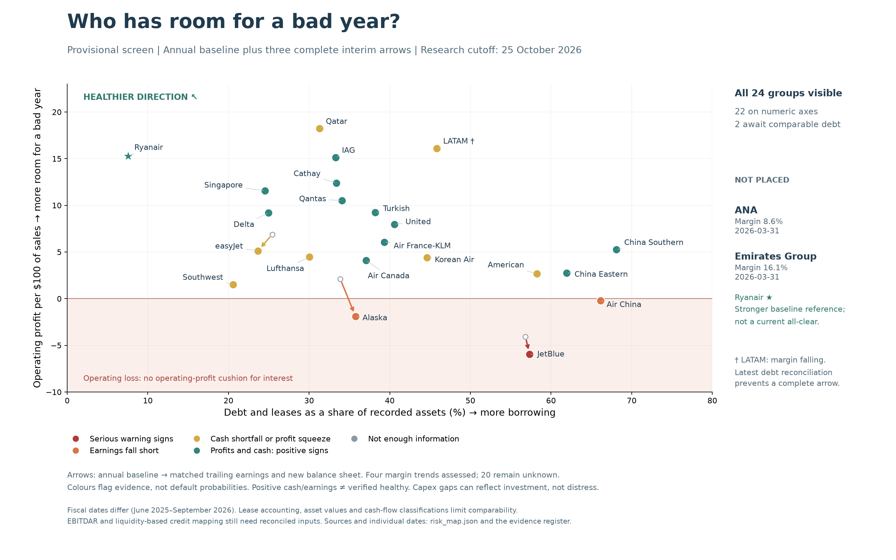
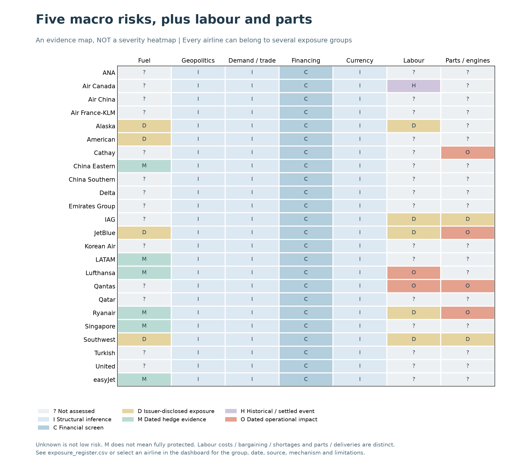

# Where is financial pressure building?

Research cutoff: **25 October 2026**. This is a provisional financial screen, not a credit rating or probability of default.

[Interactive dashboard](../reports/risk-map/index.html) (download and open in a browser) · [Financial data](../reports/risk-map/financial_map.csv) · [Exposure register](../reports/risk-map/exposure_register.csv) · [Python workbook](../notebooks/risk_map.ipynb)

Start with the [plain-English investor story](investor-story.md): how higher costs and disappointing ticket sales turn into a funding problem. The definitions below support that story.

## Read it like an investor

**How much debt supports the business?** Moving right means a larger proportion of book assets is financed by debt and identified leases. This is not debt divided by earnings, and book asset values may differ materially from realisable collateral values.

**How much earnings cushion remains?** Moving up means more operating profit per dollar of revenue. Below zero, the business loses money before financing costs. This margin does not measure cash available for repayments.

**Which way is it going?** Hollow points show the annual baseline; arrows end at matched trailing-twelve-month operating earnings and a newer balance sheet. Arrows are available for JetBlue, Alaska and easyJet. LATAM has a newer margin trend, but unresolved debt reconciliation prevents a complete arrow. The other 20 trends are unassessed. Lack of an arrow does not imply stability.

All 24 groups are represented: 22 on the numerical axes and ANA and Emirates Group in the unplaced panel. Their debt/lease comparisons remain incomplete. Periods differ; this is not a synchronized October balance-sheet snapshot.

## What the colours mean

| Colour | Evidence rule | Investor interpretation |
|---|---|---|
| Red | Dated external distress evidence | Urgent review of liquidity, losses, refinancing and contractual triggers |
| Orange | Operating profit at or below zero, or below extracted gross interest expense | Earnings do not cover the first financing hurdle |
| Amber | Negative operating cash flow less capex, or operating margin down more than 0.5 percentage points | Investigate investment needs and deterioration; neither proves distress |
| Teal | Positive operating earnings and non-negative operating cash flow less capex, without another screen trigger | A positive screen, not a verified healthy rating |
| Grey | Required financial evidence missing | No conclusion |

Rules are applied in that order. The 0.5-point trend filter is an author-selected display convention, not an industry covenant. Cash flow less capex can be negative because of fleet growth. Cash interest and lease classifications differ under US GAAP and IFRS. Alaska's latest cash-gap screen uses nine-month year-to-date cash flow; the other three updated cases use trailing periods. The exports state the basis explicitly.

## What the map currently tells us

**JetBlue requires the closest liquidity scrutiny.** Its updated operating margin is approximately −5.9%, with debt and identified leases around 57% of book assets. The red flag incorporates dated external distress evidence, not a default prediction. Its repeated losses and reverse stress conditions are explored in the [credit story](credit-story.md). Net losses are not interchangeable with cash burn.

**Alaska's earnings direction is adverse.** The updated trailing operating margin is approximately −1.9%. easyJet's margin also declines, to about 5.1%, but remains positive. LATAM's newer margin falls to about 14.7% from 16.1%; its plotted position retains the annual baseline. These are different degrees of deterioration, not equivalent distress cases.

**Ryanair is a stronger baseline reference:** relatively low debt/asset funding and a substantial operating margin. Healthy credit requires more than this position: recurring cash generation after necessary investment, sufficient unrestricted liquidity through a plausible shock, manageable maturities, and headroom against actual covenants. No airline receives a verified current all-clear from this chart.

## Five current macro channels, plus two operational overlays

These are our five selected transmission channels, not an authoritative ranking. Groups overlap. The dashboard filters by each channel and its evidence group; selecting an airline reveals dates, sources and limitations.

| Channel | How we group exposure now | What would make the assessment stronger |
|---|---|---|
| Fuel price and physical availability | Dated hedge positions, no open hedges disclosed, policy only, or unassessed | Quarterly hedge expiry, jet-fuel basis, volumes, cash collateral and physical supply |
| Geopolitics and airspace | Gulf hub concentration versus network/indirect exposure | Revenue and capacity on affected routes, rerouting costs and mitigation |
| Demand, trade and pricing | Passenger exposure, with cargo/passenger review priorities | Regional yields, bookings, capacity, cargo mix and price elasticity |
| Interest rates and refinancing | Financial-screen groups | Maturity ladder, floating debt, spreads, collateral and committed facilities |
| Currency mismatch | USD versus non-USD reporting as a review tag only | Actual USD costs/debt against revenue currencies and natural/financial hedges |
| Labour | Observed disruption, settled historical events, bargaining/cost exposure, or unassessed | Contract dates, wage commitments, staffing vacancies and licensed skills |
| Aircraft, engines and parts | Observed groundings, delivery constraints, disclosed supplier risk, or unassessed | Grounded aircraft, shop turnaround, spare engines, deliveries and compensation |

Reporting currency does not establish net currency exposure. Business-mix groups are author inferences, not measured sensitivities. A disclosed risk factor is not proof that a shortage occurred. Air Canada's settled strike is historical; Ryanair's external air-traffic-control exposure is distinct from an internal labour shortage. JetBlue's GTF groundings are distinct from Southwest's Boeing certification dependency.

The current macro selection draws on [IATA's June 2026 industry outlook](https://www.iata.org/en/iata-repository/publications/economic-reports/global-outlook-for-air-transport-june-2026/), [IATA's August traffic release](https://www.iata.org/en/pressroom/2026-releases/09-30-air-passenger-demand-slips-august/) and the [IMF October 2026 outlook](https://www.imf.org/en/Publications/WEO/Issues/2026/10/13/world-economic-outlook-october-2026). Forecast vintages are retained separately. Issuer-level evidence and exact locators are in the exposure register.

This second chart is an **evidence map, not a severity heatmap**. Unknown is not low risk; disclosed hedges do not imply full protection. There are 168 airline/channel entries, but many remain structural inferences or explicit gaps.

## Limits before assigning danger zones

The intended credit map should add harmonised lease-adjusted leverage and fixed-charge coverage, with liquidity runway and covenant headroom in each airline's detail. EBITDAR remains useful only when rent and lease treatment are reconciled; see [industry benchmarks](airline-credit-benchmarks.md). We have not substituted an EBITDA proxy and called it EBITDAR.

Remaining work: comparable interim histories for the other 20 groups; reconciled debt for ANA, Emirates and LATAM's interim; full maturity ladders and cash debt service; unrestricted liquidity and committed facilities; covenant definitions and certificates; fuel hedges by horizon; and issuer-specific labour/parts evidence. Until those are available, numerical danger boundaries or universal healthy thresholds would imply more certainty than the data supports.

## Reproduce

From the repository root, install `requirements-report.txt`, then run `python risk_map.py`. The dashboard is self-contained and makes no external data requests. `data/risk-map-evidence.json` holds dated context and operational observations; existing annual/interim datasets supply financial values. Run `python -m unittest discover -s tests` for checks.
